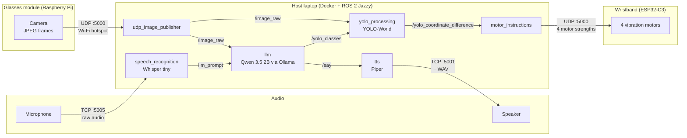

# Percepta

**A low-cost clip-on kit that helps people with central vision loss read, find and reach everyday objects on their own.**

<!-- TODO: add hero photo of the glasses module and wristband -->
<p align="center">
  
</p>

Percepta was built at **natHacks 2026** for people with age-related macular degeneration (AMD) and other forms of progressive central vision loss. People with AMD usually keep their side vision, so they can still move around a room. What they lose is the sharp centre of their vision, which makes it hard to read a label, find small objects or recognise a face. The kit has two parts: a small camera module that clips onto any pair of glasses, and a vibration wristband. You ask a question out loud ("Laura, where are my keys?" or "Laura, what does this say?"). Percepta answers by voice, or guides your hand to the object with gentle vibrations on your wrist. All of the AI runs locally on a laptop, so no images or audio are sent to the cloud.

> Percepta is a student prototype. It is not a medical device, and it has not yet been tested with people who have AMD.

---

## Table of Contents

- [Features](#features)
- [How It Works](#how-it-works)
- [What's in This Repo](#whats-in-this-repo)
- [Hardware](#hardware)
- [Tech Stack](#tech-stack)
- [Getting Started](#getting-started)
- [Usage](#usage)
- [Testing and Results](#testing-and-results)
- [Known Limits](#known-limits)
- [Privacy](#privacy)
- [What's Next](#whats-next)
- [Team](#team)
- [Credits](#credits)
- [License](#license)

---

## Features

- **Find an object.** Ask "Laura, where is my mug?" The camera finds both the mug and your hand. The wristband vibrates in the direction you need to move (left, right, up or down), and the vibration gets stronger the further away you are. It stops when your hand reaches the object.
- **Read things out loud.** Ask about a label, a letter, a menu or a medicine box, and Percepta reads it back in a natural voice.
- **Ask about what's in front of you.** A vision language model looks at the current camera frame and answers short questions about it.
- **Haptics, audio or both.** Feedback can come through the wristband, through speech, or both, so you can choose based on how noisy or busy your surroundings are.
- **Fits glasses you already own.** The camera module clips onto existing frames, so you don't need special eyewear.
- **Private by design.** Speech recognition, the language model, object detection and the voice all run on the local host. Nothing goes to a cloud service.
- **Easy to extend.** Each step is a separate ROS 2 node, so new skills such as navigation or translation can be added without rewriting the rest. See [What's Next](#whats-next).

---

## How It Works

<!-- TODO: optional photo or GIF of a hand-guidance demo -->



### Pipeline, step by step

1. **Capture.** The Raspberry Pi on the glasses starts its own Wi-Fi hotspot (`Percepta`, `192.168.50.1`) and waits for the host laptop to join. It then captures 640×480 JPEG frames at 10 FPS, splits each frame into 1200-byte UDP packets, and sends them to the host on port `5000`.
2. **Reassemble.** `udp_image_publisher` puts the packets back together, drops any frame that hasn't fully arrived within 1 second, and publishes only the newest frame to `/image_raw`. Publishing only the newest frame keeps delay low because old frames never queue up.
3. **Listen.** Microphone audio streams to `speech_recognition` over TCP port `5005`. Whisper (tiny, English) transcribes each phrase. Only phrases that contain the wake word **"Laura"** are passed on, to `llm_prompt`.
4. **Understand.** The `llm` node sends the spoken request and the latest camera frame to **Qwen 3.5 (2B)**, which runs locally through Ollama.
   - If the request is a question or a reading task, the reply is published to `/say`.
   - If the request is to find something, the model replies with the object name in square brackets (for example `[keys]`). That name is published to `/yolo_classes`.
5. **Detect.** `yolo_processing` runs **YOLO-World**, an open-vocabulary detector, so it can look for any object by name without being retrained. In every frame it finds the best match for the requested object and for the user's **hand**, then publishes the pixel offset between them on `/yolo_coordinate_difference`. An annotated debug view is published on `/yolo_output`.
6. **Translate to touch.** `motor_instructions` turns the offset into four motor strengths (left, right, up, down) between 0 and 1:
   - Strength scales from 20% when the hand is 50 px from the object up to 100% at 500 px or more.
   - All motors stop when the hand is within 15 px of the object.
   - The four values are sent to the wristband over UDP as `left,right,up,down`.
7. **Feel.** The ESP32-C3 wristband reads the packet and drives each vibration motor at the matching strength.
8. **Speak.** The `tts` node turns `/say` text into speech with **Piper** and sends the WAV over TCP port `5001` to the audio device, which plays it.

---

## What's in This Repo

```
percepta/
├── Glasses/                  # Runs on the Raspberry Pi on the glasses
│   ├── main.py               # Entry point: start hotspot, wait for host, stream
│   ├── hotspot.py            # NetworkManager hotspot + finds the host's IP
│   ├── camera.py             # Picamera2 capture and JPEG encoding
│   ├── udp_stream.py         # Splits frames into UDP packets
│   └── config.py             # All settings, overridable by environment variable
│
├── Host/                     # Runs on the laptop inside Docker
│   ├── Dockerfile            # ROS 2 Jazzy + YOLO-World + Whisper + Ollama/Qwen + Piper
│   ├── docker-entrypoint.sh  # Builds the workspace, starts Ollama, launches nodes
│   ├── .devcontainer/        # VS Code Dev Container config (ports, env)
│   └── src/percepta_host/
│       ├── launch/host_nodes.launch.py
│       └── percepta_host/
│           ├── image_retriever.py     # udp_image_publisher node
│           ├── speech_recognition.py  # Whisper speech-to-text + wake word
│           ├── llm.py                 # Qwen vision language model node
│           ├── yolo_processing.py     # YOLO-World object + hand detection
│           ├── motor_instructions.py  # Offset → 4 motor strengths → UDP
│           ├── tts.py                 # Piper text-to-speech
│           └── dummy_publisher.py     # Test publisher for development
│
├── Haptics/PerceptaHaptics/  # Wristband firmware (PlatformIO, ESP32-C3)
│   ├── platformio.ini
│   └── src/main.cpp          # Joins Wi-Fi, receives UDP, drives motors
│
└── TempMicForwarder/         # Audio bridge for the host machine
    ├── mic_forwarder.py      # Streams microphone audio to the host over TCP
    └── tts_receiver.py       # Receives and plays spoken replies
```

### ROS 2 topics

| Topic | Type | From → To | Contents |
|---|---|---|---|
| `/image_raw` | `sensor_msgs/Image` | `udp_image_publisher` → `yolo_processing`, `llm` | Newest camera frame |
| `llm_prompt` | `std_msgs/String` | `speech_recognition` → `llm` | Transcribed request containing "Laura" |
| `/say` | `std_msgs/String` | `llm` → `tts` | Text to speak |
| `/yolo_classes` | `std_msgs/String` | `llm` → `yolo_processing` | Object to look for |
| `/yolo_coordinate_difference` | `geometry_msgs/PointStamped` | `yolo_processing` → `motor_instructions` | Pixel offset from hand to object |
| `/yolo_output` | `sensor_msgs/Image` | `yolo_processing` → (debug) | Frame with detection boxes drawn |

### Network ports

| Port | Protocol | Direction | Purpose |
|---|---|---|---|
| 5000 | UDP | Glasses → Host | Camera frames |
| 5005 | TCP | Audio device → Host | Microphone audio |
| 5001 | TCP | Host → Audio device | Spoken replies (WAV) |
| 5000 | UDP | Host → Wristband | Motor strengths |
| 11434 | TCP | Inside container | Ollama API |

---

## Hardware

<!-- TODO: photos of each assembled part -->

| Part | Used for | Qty | Approx. cost (CAD) |
|---|---|---|---|
| TODO: Raspberry Pi model | Glasses compute + Wi-Fi hotspot | 1 | TODO |
| TODO: Camera module | Video capture | 1 | TODO |
| LOLIN C3 Mini (ESP32-C3) | Wristband controller | 1 | TODO |
| TODO: Vibration motor type | Directional haptics (left, right, up, down) | 4 | TODO |
| TODO: Motor driver | Powers the motors from the ESP32 | TODO | TODO |
| TODO: Battery (glasses) | Power for the Pi | 1 | TODO |
| TODO: Battery (wristband) | Power for the ESP32 + motors | 1 | TODO |
| TODO: Glasses mount / enclosure | Clip-on housing for the camera module | 1 | TODO |
| TODO: Wristband strap / enclosure | Holds motors against the wrist | 1 | TODO |
| TODO: Microphone + speaker | Voice input and spoken replies | TODO | TODO |
| **Total** | | | **TODO** |

**Host computer:** any laptop that can run Docker. TODO: list the laptop used for the demo (CPU, RAM, GPU yes/no).

<!-- TODO: wiring diagram for the wristband (ESP32 pins → driver → motors) -->

---

## Tech Stack

- **Glasses:** Python, Picamera2, NetworkManager (`nmcli`)
- **Host:** ROS 2 Jazzy in Docker, OpenCV, cv_bridge
- **Vision:** Ultralytics YOLO-World (`yolov8s-worldv2`) with CLIP
- **Language and vision model:** Qwen 3.5 2B served by Ollama
- **Speech to text:** OpenAI Whisper (tiny) via SpeechRecognition
- **Text to speech:** Piper (`en_US-hfc_female-medium`)
- **Wristband:** C++ (Arduino framework) on ESP32-C3, built with PlatformIO
- **Audio bridge:** Python, sounddevice

---

## Getting Started

### Prerequisites

- **Host laptop:** Docker (and optionally VS Code with the Dev Containers extension). The image is several GB because it includes the models.
- **Glasses:** A Raspberry Pi running Raspberry Pi OS with a camera module, `python3-picamera2` and NetworkManager.
- **Wristband:** [PlatformIO](https://platformio.org/) (CLI or VS Code extension) and a USB-C cable.
- **Audio device:** Python 3.9+ and a microphone and speaker.

### 1. Clone the repo

```bash
git clone https://github.com/11Deniss11/percepta.git
cd percepta
```

### 2. Set up the glasses (Raspberry Pi)

Copy the `Glasses/` folder to the Pi, then run:

```bash
cd Glasses
sudo python3 main.py
```

The Pi starts a hotspot called `Percepta` and waits for the host laptop to join. Every setting can be changed with an environment variable:

| Variable | Default | Meaning |
|---|---|---|
| `AP_SSID` / `AP_PASSWORD` | `Percepta` / `percepta-camera` | Hotspot name and password. **Change the password.** |
| `AP_ADDRESS` | `192.168.50.1` | Pi's address on the hotspot |
| `UDP_PORT` | `5000` | Port the frames are sent to |
| `FRAME_RATE` | `10` | Frames per second |
| `JPEG_WIDTH` / `JPEG_HEIGHT` | `640` / `480` | Frame size |
| `JPEG_QUALITY` | `75` | JPEG quality (lower is faster) |
| `LEASE_TIMEOUT` | `300` | Seconds to wait for the host to join |

Example:

```bash
sudo AP_PASSWORD="choose-a-strong-password" FRAME_RATE=15 python3 main.py
```

### 3. Flash the wristband (ESP32-C3)

1. Open `Haptics/PerceptaHaptics/src/main.cpp` and set `wifi_ssid` and `wifi_password` to the network the host is on.
2. Build and upload:

   ```bash
   cd Haptics/PerceptaHaptics
   pio run -t upload
   pio device monitor   # prints the wristband's IP address
   ```

3. Note the IP address it prints. You'll pass it to the host in step 4.

### 4. Start the host (laptop)

Connect the laptop to the `Percepta` hotspot first.

**Option A: VS Code Dev Container.** Open the `Host/` folder in VS Code and choose **Reopen in Container**. The ports are already configured.

**Option B: plain Docker.**

```bash
cd Host
docker build -t percepta-host .
docker run --rm -it \
  -p 5000:5000/udp \
  -p 5005:5005/tcp \
  --ipc=host \
  -e ROS_DOMAIN_ID=10 \
  percepta-host
```

The entrypoint builds the ROS 2 workspace, starts Ollama, and launches all nodes. The first start can take a minute while the models load.

To point the motor commands at your wristband, set its IP address:

```bash
ros2 param set /motor_instructions udp_address <wristband-ip>
```

### 5. Start the audio bridge

On the machine with the microphone and speaker:

```bash
cd TempMicForwarder
pip install -r requirements.txt
python mic_forwarder.py     # sends microphone audio to the host
python tts_receiver.py      # plays spoken replies (run in a second terminal)
```

---

## Usage

1. Put on the glasses and the wristband, and start every part as described above.
2. Wait for the host log to say `Ready! Listening for TCP audio streams...`.
3. Start every request with the wake word **"Laura"**.

| Say | What happens |
|---|---|
| "Laura, where are my keys?" | The wristband guides your hand toward the keys and stops when you reach them. |
| "Laura, what does this label say?" | Percepta reads the text out loud. |
| "Laura, what colour is this shirt?" | Percepta answers out loud from the current camera view. |

**Tips:** Keep your hand inside the camera's view while it is guiding you. Bright, even lighting works best.

To see what the camera and detector see while debugging, view `/yolo_output` with `rqt_image_view` or RViz.

---

## Testing and Results

We will fill this table in with numbers we actually measure. Any cell marked TBD has not been tested yet.

| What we measure | How we measure it | Result |
|---|---|---|
| Camera frame rate at the host | Read from the `udp_image_publisher` log (it reports frames received every 10 s) | TBD |
| Delay: end of speech → start of spoken reply | Stopwatch or screen recording, median of N trials | TBD |
| Delay: end of speech → first wristband vibration | Same method, median of N trials | TBD |
| Wake word reliability | Out of N requests that say "Laura", how many are picked up; also count false triggers over 10 minutes of normal talk | TBD |
| Object found | Out of N trials across a set of common objects (keys, mug, phone, pill bottle, remote), how often the object is detected within 10 s | TBD |
| Guided reach success | Out of N trials with a tester's vision blocked or blurred, how often they touch the object within 30 s using haptics only | TBD |
| Time to reach | Median seconds from the request to touching the object | TBD |
| Reading accuracy | Percentage of words read correctly from sample labels, letters and menus | TBD |
| Battery life | Hours of continuous use for the glasses and for the wristband | TBD |
| Weight on the glasses | Grams added to the frames | TBD |
| Parts cost | Total from the [Hardware](#hardware) table | TBD |

**Who tested it:** TBD. If the testers were sighted team members using blindfolds or low-vision simulation glasses, we will say so here. We will not present their results as feedback from people with vision loss.

---

## Known Limits

- **Needs a laptop nearby.** The models run on a host laptop, so the glasses and wristband have to stay on the same network as it.
- **2D guidance only.** The camera has no depth sensing. The wristband guides left, right, up and down in the image, and cannot yet tell how far forward to reach.
- **Your hand must be in view.** Hand guidance only works while the camera can see both your hand and the object.
- **Detection can be wrong.** YOLO-World runs with a low confidence threshold so it catches more objects, which also means it sometimes picks the wrong one. Results get worse in poor lighting or with small, cluttered or shiny objects.
- **English only, wake word required.** Speech recognition uses Whisper tiny in English, and every request must include "Laura". Accents, background noise or a misheard wake word can cause missed requests.
- **One request at a time.** The model looks only at the latest frame and has no memory of earlier requests.
- **Not yet tested with the people it's for.** We have not tested Percepta with people who have AMD. Real-world use will need their input before anyone relies on it.
- **Not a medical device.** Percepta assists with everyday tasks. It does not diagnose, treat or replace a cane, guide dog, or low-vision care.

---

## Privacy

A camera on someone's face raises fair questions, so we designed for privacy from the start:

- **Nothing leaves your devices.** Speech recognition, the language model, object detection and text-to-speech all run inside the local Docker container. No cloud APIs are called.
- **No recordings are kept.** Camera frames are held in memory only long enough to process them and are never saved to disk. The only file written is a temporary WAV of the latest spoken reply, which is overwritten each time.
- **A private network.** The glasses stream over their own password-protected hotspot rather than a public network.
- **Only when asked.** The language model only looks at a frame when you say the wake word.

**Before using this outside a demo:** change the default hotspot password and the Wi-Fi details in the wristband firmware. Never commit real passwords to the repo.

---

## What's Next

- **User testing.** Run sessions with people who have AMD, together with low-vision rehabilitation professionals, and let their feedback set our priorities.
- **Depth guidance.** Add a depth sensor or stereo camera so the wristband can guide forward and back as well.
- **Navigation.** Add warnings for obstacles at head height, which a white cane can miss.
- **Translation.** Read text in other languages and speak it back in the user's language.
- **Face recognition (opt-in).** Recognise family and friends the user has chosen to enrol, to help with social connection.
- **More languages and wake words.** Let users pick their own wake word and language.
- **Fully wearable.** Move processing to a phone or a small onboard computer so the laptop isn't needed.
- **Smaller hardware.** Shrink and lighten the glasses module and wristband.

---

## Team

| Name | Role |
|---|---|
| Denis Cuznetov | Software |
| Jason TODO | Software |
| Dhaya Srinivasan | Hardware |
| Amitoj Phagura | Hardware |
| Henry TODO | Hardware |
| Henock TODO | Finance, pitch and business |

---

## Credits

**Libraries and models**

- [ROS 2 Jazzy](https://docs.ros.org/en/jazzy/)
- [Ultralytics YOLO-World](https://docs.ultralytics.com/models/yolo-world/) and [Ultralytics CLIP](https://github.com/ultralytics/CLIP)
- [Ollama](https://ollama.com/) with Qwen 3.5 (2B)
- [OpenAI Whisper](https://github.com/openai/whisper) through [SpeechRecognition](https://github.com/Uberi/speech_recognition)
- [Piper TTS](https://github.com/rhasspy/piper)
- [Picamera2](https://github.com/raspberrypi/picamera2), [OpenCV](https://opencv.org/), [sounddevice](https://python-sounddevice.readthedocs.io/)
- [PlatformIO](https://platformio.org/) and [Arduino-ESP32](https://github.com/espressif/arduino-esp32)

**Research**

- Statistics on vision loss in Canada come from CNIB and its published reports. TODO: add links.

**Advisors**

- TODO: list advisors who agreed to be credited, with their permission.

**Event**

- Built at natHacks 2026, hosted by NeurAlbertaTech at the University of Alberta.

---

## License

This project is licensed under the MIT License. See [LICENSE](LICENSE) for details.
