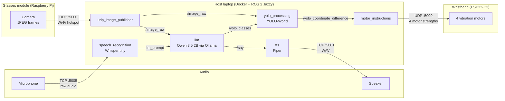

# Percepta

**A low-cost kit that helps people with central vision loss read, find and reach everyday objects on their own.**

**To Do, add image of prototype here.**

Percepta was built at natHacks 2026 for people with age-related macular degeneration (AMD) and other forms of progressive central vision loss. People with AMD usually keep their side vision, so they can still move around a room. What they lose is the sharp centre of their vision, which makes it hard to read a label, find small objects or recognise a face. The kit has two parts: a small camera module that attaches onto any pair of glasses, and a vibration wristband. You ask a question out loud ("Laura, where are my keys?" or "Laura, what does this say?"). Percepta answers by voice, or guides your hand to the object with gentle vibrations on your wrist. All of the AI runs locally on a laptop, so no images or audio are sent to the cloud.

> Please note that Percepta is a student prototype. It is not a medical device, and it has not yet been tested with people who have AMD.

---

## Table of Contents

- [Features](#features)
- [How It Works](#how-it-works)
- [What's in This Repo](#whats-in-this-repo)
- [Hardware](#hardware)
- [Tech Stack](#tech-stack)
- [Getting Started/Usage](#getting-started)
- [Testing and Results](#testing-and-results)
- [Privacy](#privacy)
- [What's Next](#whats-next)
- [Team](#team)
- [Credits](#credits)
- [License](#license)

---

## Features

- **Find an object.** Ask "Laura, where is my mug?" The camera finds both the mug and your hand. The wristband vibrates in the direction you need to move (left, right, front or back), and the vibration gets stronger the further away you are. It stops when your hand reaches the object.
- **Read things out loud.** Ask about a label, a letter, a menu or a medicine box, and Percepta reads it back in a natural voice.
- **Ask about what's in front of you.** A vision language model looks at the current camera frame and answers short questions about it.
- **Haptics, audio or both.** Feedback can come through the wristband, through speech, or both, so you can choose based on how noisy or busy your surroundings are.
- **Fits glasses you already own.** The camera module clips onto existing frames, so you don't need special eyewear.
- **Private by design.** Speech recognition, the language model, object detection and the voice all run on the local host. Nothing goes to a cloud service.
- **Easy to extend.** Each step is a separate ROS 2 node, so new skills such as navigation or translation can be added without rewriting the rest. See [What's Next](#whats-next).

---

## How It Works

<!-- TODO: optional photo or GIF of a hand-guidance demo -->



### Pipeline, step by step

1. **Capture.** The host laptop starts a 2.4 GHz Wi-Fi hotspot. The Raspberry Pi and ESP32 join that hotspot. The Pi discovers the laptop gateway (or uses `HOST_IP`) and captures 640×480 JPEG frames at 10 FPS, splits each frame into 1200-byte UDP packets, and sends them to the host on port `5000`.
2. **Reassemble.** `udp_image_publisher` puts the packets back together, drops any frame that hasn't fully arrived within 1 second, and publishes only the newest frame to `/image_raw`. Publishing only the newest frame keeps delay low because old frames never queue up.
3. **Listen.** Microphone audio streams to `speech_recognition` over TCP port `5005`. Whisper (tiny, English) transcribes each phrase. Only phrases that contain the wake word **"Laura"** are passed on, to `llm_prompt`.
4. **Understand.** The `llm` node sends the spoken request and the latest camera frame to **Qwen 3.5 (2B)**, which runs locally through Ollama.
   - If the request is a question or a reading task, the reply is published to `/say`.
   - If the request is to find something, the model replies with the object name in square brackets (for example `[keys]`). That name is published to `/yolo_classes`.
5. **Detect.** `yolo_processing` runs **YOLO-World**, an open-vocabulary detector, so it can look for any object by name without being retrained. In every frame it finds the best match for the requested object and for the user's **hand**, then publishes the pixel offset between them on `/yolo_coordinate_difference`. An annotated debug view is published on `/yolo_output`.
6. **Translate to touch.** `motor_instructions` turns the offset into four motor strengths (left, right, up, down) between 0 and 1:
   - Strength scales from 20% when the hand is 50 px from the object up to 100% at 500 px or more.
   - All motors stop when the hand is within 15 px of the object.
   - The four values are sent to the wristband over UDP as `left,right,up,down`.
7. **Feel.** The ESP32-C3 wristband reads the packet and drives each vibration motor at the matching strength.
8. **Speak.** The `tts` node turns `/say` text into speech with **Piper** and sends the WAV over TCP port `5001` to the audio device, which plays it.

---

## What's in This Repo

```
percepta/
├── Glasses/                  # Runs on the Raspberry Pi on the glasses
│   ├── main.py               # Entry point: find host, then stream
│   ├── hotspot.py            # Finds the laptop hotspot gateway
│   ├── camera.py             # Picamera2 capture and JPEG encoding
│   ├── udp_stream.py         # Splits frames into UDP packets
│   └── config.py             # All settings, overridable by environment variable
│
├── Host/                     # Runs on the laptop inside Docker
│   ├── Dockerfile            # ROS 2 Jazzy + YOLO-World + Whisper + Ollama/Qwen + Piper
│   ├── docker-entrypoint.sh  # Builds the workspace, starts Ollama, launches nodes
│   ├── .devcontainer/        # VS Code Dev Container config (ports, env)
│   └── src/percepta_host/
│       ├── launch/host_nodes.launch.py
│       └── percepta_host/
│           ├── image_retriever.py     # udp_image_publisher node
│           ├── speech_recognition.py  # Whisper speech-to-text + wake word
│           ├── llm.py                 # Qwen vision language model node
│           ├── yolo_processing.py     # YOLO-World object + hand detection
│           ├── motor_instructions.py  # Offset → 4 motor strengths → UDP
│           ├── tts.py                 # Piper text-to-speech
│           └── dummy_publisher.py     # Test publisher for development
│
├── Haptics/PerceptaHaptics/  # Wristband firmware (PlatformIO, ESP32-C3)
│   ├── platformio.ini
│   └── src/main.cpp          # Joins Wi-Fi, receives UDP, drives motors
│
└── TempMicForwarder/         # Audio bridge for the host machine
    ├── mic_forwarder.py      # Streams microphone audio to the host over TCP
    └── tts_receiver.py       # Receives and plays spoken replies
```

### ROS 2 topics

| Topic | Type | From → To | Contents |
|---|---|---|---|
| `/image_raw` | `sensor_msgs/Image` | `udp_image_publisher` → `yolo_processing`, `llm` | Newest camera frame |
| `llm_prompt` | `std_msgs/String` | `speech_recognition` → `llm` | Transcribed request containing "Laura" |
| `/say` | `std_msgs/String` | `llm` → `tts` | Text to speak |
| `/yolo_classes` | `std_msgs/String` | `llm` → `yolo_processing` | Object to look for |
| `/yolo_coordinate_difference` | `geometry_msgs/PointStamped` | `yolo_processing` → `motor_instructions` | Pixel offset from hand to object |
| `/yolo_output` | `sensor_msgs/Image` | `yolo_processing` → (debug) | Frame with detection boxes drawn |

### Network ports

| Port | Protocol | Direction | Purpose |
|---|---|---|---|
| 5000 | UDP | Glasses → Host | Camera frames |
| 5005 | TCP | Audio device → Host | Microphone audio |
| 5001 | TCP | Host → Audio device | Spoken replies (WAV) |
| 5000 | UDP | Host → Wristband | Motor strengths |
| 11434 | TCP | Inside container | Ollama API |

---

## Hardware

### Glasses module

A clip-on module that attaches to the user's own glasses. The Raspberry Pi and the battery sit on opposite temples to balance the weight, and the camera faces forward from a plate on the front of the frame.

| Part | Used for | Qty | Price (USD) |
|---|---|---|---|
| Raspberry Pi Zero 2 W (with headers) | Captures and streams video, runs the Wi-Fi hotspot | 1 | $19.60 |
| Pi camera module (OV5647 clone) | Forward-facing camera | 1 | ~$8.00 |
| 3.7 V 500 mAh LiPo battery | Power | 1 | ~$5.00 |
| Boost converter (3.7 V to 5 V) | Steps battery voltage up for the Pi | 1 | ~$1.50 |
| 3D printing filament (~30 g) | Clips, cases and camera plate | 1 | ~$0.60 |
| **Total** | | | **~$34.70** |

**3D printed parts**

- **Glasses clips and pins:** two pin-lock clips (one uses two pins) that attach the module to existing frames. The cases are glued onto the clips. The pins are chamfered, with a radius 0.1 mm smaller than the clip holes for a snug fit.
- **Camera plate:** a hook-style plate over one lens of the glasses. The camera is held in with a heat-set insert, and the plate gives the ribbon cable a clean path back to the Pi.
- **Pi case:** a simple box with an opening for the header wires.
- **Battery case:** sized for the LiPo, with an opening at the top. TODO: update once we know how the battery is charged.

### Haptic wristband

Four vibration motors sit around the wrist, one for each direction (left, right, up, down). They're held between two fabric layers: a sock on the outside for compression, and pantyhose on the inside, which passes the vibration through without damping it. The ESP32, battery and charger share one 3D printed case.

| Part | Used for | Qty | Price (USD) |
|---|---|---|---|
| ESP32-C3 Super Mini | Receives motor commands over Wi-Fi, drives the motors | 1 | $5.00 |
| 10 mm coin vibration motor | Directional haptic feedback | 4 | $6.00 ($1.50 each) |
| 3.7 V 400 mAh LiPo battery | Power | 1 | ~$5.00 (est.) |
| LiPo charging board | Recharges the battery | 1 | ~$1.00 (est.) |
| Solid core wire | Motor and power wiring | | ~$5.00 |
| Sock | Outer layer, compression | 1 | ~$5.93 (CA$8.30) |
| Pantyhose | Inner layer, against the skin | 1 | ~$5.72 (CA$8.00) |
| 3D printing filament | Motor brackets and electronics case | | ~$1.00 |
| Hot glue | Fixing motors to brackets and brackets to fabric | | negligible |
| **Total** | | | **~$34.65** |

**Assembly notes**

- Each motor is hot glued onto a printed bracket. The bracket is then glued and stitched to the sock, and the pantyhose is stitched in on the inside.
- The motor wires are laid in a zig-zag and partly stitched down so they spring back when the band stretches.
- The motor grounds are soldered in a chain onto one shared ground wire. The charger board's ground joins the same wire.

### Audio

- **Microphone:** a DJI wireless mic for the demo. Any microphone the host can read works, including the laptop's built-in mic.
- **Speaker:** the laptop's speakers for the demo. Any speaker works.

**Kit total: ~$69 USD** (glasses ~$34.70 + wristband ~$34.65), not counting the host laptop.

**To Do: Add schematics, diagrams, photos, etc for hardware.**

---

## Tech Stack

- **Glasses:** Python, Picamera2, NetworkManager (`nmcli`)
- **Host:** ROS 2 Jazzy in Docker, OpenCV, cv_bridge
- **Vision:** Ultralytics YOLO-World (`yolov8s-worldv2`) with CLIP
- **Language and vision model:** Qwen 3.5 2B served by Ollama
- **Speech to text:** OpenAI Whisper (tiny) via SpeechRecognition
- **Text to speech:** Piper (`en_US-hfc_female-medium`)
- **Wristband:** C++ (Arduino framework) on ESP32-C3, built with PlatformIO
- **Audio bridge:** Python, sounddevice

---

## Getting Started / Usage
**To Do: Jason wanted to do this.**

1. Put on the glasses and the wristband, and start every part as described above.
2. Wait for the host log to say `Ready! Listening for TCP audio streams...`.
3. Start every request with the wake word **"Laura"**.

| Say | What happens |
|---|---|
| "Laura, where are my keys?" | The wristband guides your hand toward the keys and stops when you reach them. |
| "Laura, what does this label say?" | Percepta reads the text out loud. |
| "Laura, what colour is this shirt?" | Percepta answers out loud from the current camera view. |

---

## Testing and Results

**To Do: Do the tests and fill in results.**

| What we measure | How we measure it | Result |
|---|---|---|
| Camera frame rate at the host | Read from the `udp_image_publisher` log (it reports frames received every 10 s) | TBD |
| Delay: end of speech → start of spoken reply | Stopwatch or screen recording, median of N trials | TBD |
| Delay: end of speech → first wristband vibration | Same method, median of N trials | TBD |
| Wake word reliability | Out of N requests that say "Laura", how many are picked up; also count false triggers over 10 minutes of normal talk | TBD |
| Object found | Out of N trials across a set of common objects (keys, mug, phone, pill bottle, remote), how often the object is detected within 10 s | TBD |
| Guided reach success | Out of N trials with a tester's vision blocked or blurred, how often they touch the object within 30 s using haptics only | TBD |
| Time to reach | Median seconds from the request to touching the object | TBD |
| Reading accuracy | Percentage of words read correctly from sample labels, letters and menus | TBD |
| Battery life | Hours of continuous use for the glasses and for the wristband | TBD |
| Weight on the glasses | Grams added to the frames | TBD |
| Parts cost | Total from the [Hardware](#hardware) table | TBD |

---

## Privacy

A camera on someone's face raises fair questions, so we designed for privacy from the start:

- **Nothing leaves your devices.** Speech recognition, the language model, object detection and text-to-speech all run inside the local Docker container. No cloud APIs are called.
- **No recordings are kept.** Camera frames are held in memory only long enough to process them and are never saved to disk. The only file written is a temporary WAV of the latest spoken reply, which is overwritten each time.
- **A private network.** The glasses stream over their own password-protected hotspot rather than a public network.
- **Only when asked.** The language model only looks at a frame when you say the wake word.

---

## What's Next

- **User testing.** Run sessions with people who have AMD, together with low-vision rehabilitation professionals, and let their feedback set our priorities.
- **Depth guidance.** Add a depth sensor or stereo camera so the wristband can guide forward and back as well.
- **Navigation.** Add warnings for obstacles at head height, which a white cane can miss.
- **Translation.** Read text in other languages and speak it back in the user's language.
- **Face recognition (opt-in).** Recognise family and friends the user has chosen to enroll, to help with social connection.
- **More languages and wake words.** Let users pick their own wake word and language.
- **Fully wearable.** Move processing to a phone or a small onboard computer so the laptop isn't needed.
- **Smaller hardware.** Shrink and lighten the glasses module and wristband.

---

## Team

| Name | Role |
|---|---|
| Denis Cuznetov | Software |
| Jason | Software |
| Dhaya Srinivasan | Hardware |
| Amitoj Phagura | Hardware |
| Henry | Hardware |
| Henock | Finance, pitch and business |

---

## Credits

**Libraries and models**

- [ROS 2 Jazzy](https://docs.ros.org/en/jazzy/)
- [Ultralytics YOLO-World](https://docs.ultralytics.com/models/yolo-world/) and [Ultralytics CLIP](https://github.com/ultralytics/CLIP)
- [Ollama](https://ollama.com/) with Qwen 3.5 (2B)
- [OpenAI Whisper](https://github.com/openai/whisper) through [SpeechRecognition](https://github.com/Uberi/speech_recognition)
- [Piper TTS](https://github.com/rhasspy/piper)
- [Picamera2](https://github.com/raspberrypi/picamera2), [OpenCV](https://opencv.org/), [sounddevice](https://python-sounddevice.readthedocs.io/)
- [PlatformIO](https://platformio.org/) and [Arduino-ESP32](https://github.com/espressif/arduino-esp32)
**To Do: Get Denis to add other sources used.**

**Research**

- Statistics on vision loss in Canada come from CNIB and its published reports.
**To Do: Get Henock to add other links.**

## License

This project is licensed under the MIT License. See [LICENSE](LICENSE) for details.
